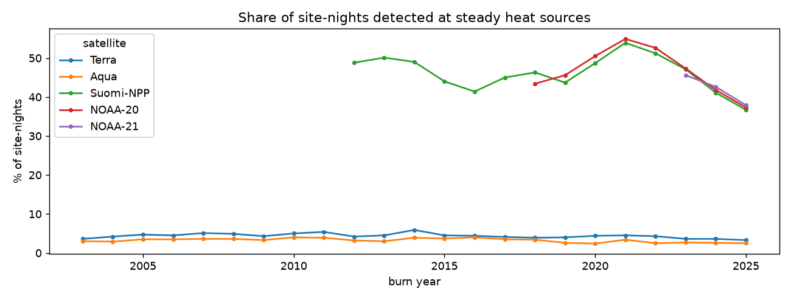

# Block 2 findings: observation effort

Source: `notebooks/02_observation_effort.ipynb`, run on 2026-11-14. Plan: `docs/eda-plan.md`, block 2.
Inputs: the hotspot table and the quality flags of block 1. Days are `burn_date`.

The table has detections only: no clouds and no list of overpasses. This block measures indirectly
how well each satellite was watching. Statements marked **(inference)** are a reading of the numbers,
not something they prove.

## Decisions

| Decision | Value | Evidence |
|---|---|---|
| Wording for "no hotspots" in the app (2.4) | "No hotspots detected. This does not mean there was no fire: clouds, small or short fires and the hours of the satellite passes can hide one." | A steady heat source is reported on about half the nights by VIIRS and on 2 to 4% by MODIS |
| Night fires in the MODIS era | State that they are estimated, not observed | At the same steady sources on the same nights, VIIRS reports 13 to 23 times as often as MODIS |
| Winter months | Read low winter counts with care in central and southern Chile and in Neuquén | The detection rate of steady sources falls by about half from summer to winter there |
| South of 40°S | No statement about observation quality | There is no steady source to test with |
| Number of satellites | Never add satellites together; one satellite per period | Satellites with detections per day go from 1 to 5 over the record |

## 2.1 How many satellites were watching

Satellites with at least one detection in Chile and Argentina, mean per day:

| Years | Satellites per day | Which |
|---|---|---|
| 2000-2001 | 1.0 | Terra |
| 2003-2011 | 2.0 | Terra, Aqua |
| 2013-2017 | 3.0 | + Suomi-NPP |
| 2019-2021 | 4.0 | + NOAA-20 |
| 2023-2025 | 4.8 to 5.0 | + NOAA-21 |

- Any count that adds satellites grows fivefold for this reason alone. The harmonized series and the
  risk target use one satellite per period for that reason.
- 2022 has days with only 2 of its 4 satellites reporting: the outages of block 1.

**Two orbits over the same place.** Share of the cell-passes with fire (0.25° cell, satellite, day,
pass; 2019-2021) that were detected by two consecutive orbits, about 100 minutes apart:

| Latitude | Suomi-NPP | Aqua |
|---|---|---|
| 20°S to 30°S | 7.6% | 0.0% |
| 30°S to 40°S | 9.4% | 0.7% |
| 40°S to 50°S | 12.7% | 2.8% |
| 50°S to 60°S | 15.7% | 8.3% (12 cases) |

The orbits overlap more towards the pole, so the south gets a second look more often. With the wide
VIIRS swath it is 8 to 16% of the cases; with MODIS it almost never happens north of 40°S.

## 2.2 Steady heat sources as witnesses

A gas flare or a smelter is hot every night. When a satellite does not report it, the cause is the
satellite, the clouds or the sensor, not the absence of heat. The static sources that the quality
filter removes (398,084 rows) are therefore a test of the observation itself.

Sites: 0.05° boxes inside the block 1 mask that Suomi-NPP detected on at least 1,000 nights in
2013-2025. There are **19**: Paraná and Buenos Aires 7, northern Chile desert 5, central and
southern Chile 5, Neuquén basin 2. Night passes only.

### The same sources, the same nights, four satellites (2019-2021)

Share of nights each satellite reported each site:

| Zone | Terra | Aqua | Suomi-NPP | NOAA-20 |
|---|---|---|---|---|
| Central and southern Chile | 6.2% | 3.6% | 51.5% | 52.3% |
| Northern Chile desert | 4.9% | 2.9% | 50.1% | 51.4% |
| Paraná and Buenos Aires | 2.6% | 1.4% | 48.1% | 50.6% |
| Neuquén basin | 0.4% | 0.0% | 40.1% | 41.7% |
| All sites | 3.9% | 2.2% | 48.7% | 50.3% |

- **VIIRS reports a steady source on about half the nights; MODIS on 2 to 4%.** NOAA-20 against Aqua
  is 23 to 1; against Terra, 13 to 1.
- This matches block 3, where the night ratio for fires was 13 to 19. It is direct evidence that the
  night gap between the sensors is about sensitivity, not about how many pixels a fire fills:
  a site here is one small source.
- The sites were chosen with Suomi-NPP, which favours it. NOAA-20 was not used to choose them and
  gives the same rate, so the choice is not what makes VIIRS look good.
- Even VIIRS misses a source that is always on half the time.

### Over the years

- The three VIIRS satellites agree within 2 points every year (2025: 36.7%, 37.3%, 37.9%).
- Their common rate moves between 37% and 55% from year to year. Because all three move together,
  the sources themselves changed (more or less flaring or production), not the satellites
  **(inference)**. The rate is therefore a comparison between satellites, not a measure of cloud
  cover over time.
- MODIS stays between 2.4% and 5.9%, with no step at the 2018 collection change. Aqua is lower from
  2019 on (2.4 to 3.4%, against 3.0 to 4.0% before).

### Over the months

Suomi-NPP, 2013-2025, share of site-nights detected per calendar month:

| Zone | Highest | Lowest | Drop |
|---|---|---|---|
| Central and southern Chile | 65% (February) | 34% (July) | about half |
| Neuquén basin | 31% (November) | 15% (July) | about half |
| Northern Chile desert | 60% (February) | 42% (June) | about a third |
| Paraná and Buenos Aires | 55% (November) | 37% (July) | about a third |

- Steady sources are reported less in winter everywhere. The most likely cause is cloud cover
  **(inference)**: a flare stands out more against a cold winter night, not less.
- So a winter month with few hotspots in central and southern Chile or in Neuquén is partly a month
  that was watched less. The calendar's summer peaks in Chile are not created by this (the fire
  season there is in summer for well-known reasons), but winter counts are a lower bound.

## 2.3 Where this test does not reach

- All 19 sites are between 22°S and 40°S. **There is no witness south of 40°S**, so nothing here says
  how well Patagonia is observed. The regions with fewest days with hotspots are there (Aysén 18 days
  a year, Tierra del Fuego 28, Magallanes 40) and in the far north (Arica y Parinacota 39, Tarapacá
  59): the table cannot tell little fire from poor observation in those regions.
- External cloud data (optional in the plan) was not used.

## Limits

- 19 sites, 2 of them in the Neuquén basin. The zone figures are small samples.
- The sites are defined by where VIIRS detects often. Steady sources that VIIRS rarely sees are not
  in the test.
- A flare is not a vegetation fire: it is small, very hot and constant. The detection rates apply to
  that kind of source.
- "A satellite was operating" means it reported at least one detection somewhere that night.
- Daytime was not tested: sun glint and warm ground make steady sources a poor witness by day.
