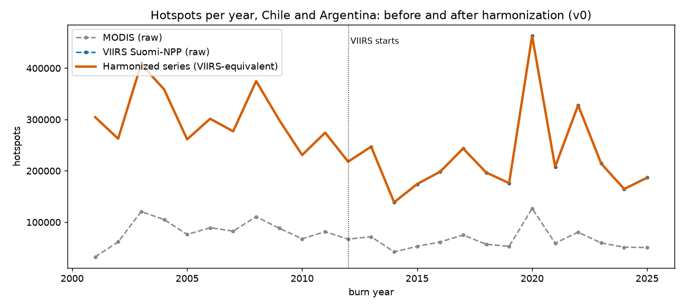

# Harmonization v0: first harmonized dataset

Source: `scripts/harmonize.py`, run on 2026-11-14. This is the first version, published early so the
web app can use real data. Block 3 of `docs/eda-plan.md` replaces the method.

## What it produces

`NASA_Data_Sources/processed/harmonized/cells_daily.parquet` (contract C2 in `docs/work-split.md`):
1,089,832 rows, 3 MB. One row per 0.25° cell, `burn_date`, region and sensor with fire.
The harmonized count of any area and period is the sum of `hotspots_harmonized`.

Also `factors.csv` (the factors applied) and `validation_yearly.csv`.

## Method

- Units: **VIIRS-equivalent hotspots**.
- One sensor per period: MODIS before 2012-02-01, VIIRS Suomi-NPP until 2026-10-31, VIIRS NOAA-20 after.
- Factor = Suomi-NPP count / MODIS count on 2012-2021, per country and calendar month.
- A second set of factors, from Terra rows only, for the period before Aqua (before 2002-07-04).
- Filter: vegetation fires only (`fire_type` 0). NRT rows have no `fire_type` and are kept.
  Confidence is not filtered yet (decision pending in block 1.7).

## Factors

| Country | Range over the 12 months (Terra + Aqua) | Terra only |
|---|---|---|
| Argentina | 3.10 (August) to 3.92 (March) | 7.3 to 15.0 |
| Chile | 2.85 (November) to 4.01 (July) | 5.4 to 22.0 |

## Validation

MODIS in the overlap years, scaled with the factors, against what Suomi-NPP really saw.

| Year | VIIRS | MODIS scaled | Error |
|---|---|---|---|
| 2012 | 192,210 | 203,637 | +5.9% |
| 2013 | 247,105 | 242,180 | -2.0% |
| 2014 | 138,735 | 144,763 | +4.3% |
| 2015 | 174,251 | 180,659 | +3.7% |
| 2016 | 198,340 | 207,467 | +4.6% |
| 2017 | 243,635 | 256,029 | +5.1% |
| 2018 | 196,814 | 193,112 | -1.9% |
| 2019 | 176,028 | 179,314 | +1.9% |
| 2020 | 462,790 | 430,230 | -7.0% |
| 2021 | 207,818 | 200,335 | -3.6% |
| 2022 (test) | 327,832 | 280,368 | -14.5% |
| 2023 (test) | 214,412 | 209,503 | -2.3% |
| 2024 (test) | 164,587 | 173,219 | +5.2% |
| 2025 (test) | 186,670 | 175,097 | -6.2% |

Median absolute error of the monthly count per country (months with at least 500 VIIRS hotspots):

| Country | Fit years 2012-2021 | Test years 2022-2025 |
|---|---|---|
| Argentina | 6.2% | 8.7% |
| Chile | 11.6% | 25.6% |

## Limits of v0

- The fit years are scored with factors fitted on those same years. Leave-one-year-out comes with block 3.
- Chile is weak: one factor per month for the whole country does not hold, least of all in the
  drift years. Block 3 tests factors per region or fire regime.
- The years with most fire are underestimated (2020: -7%, 2022: -14.5%): the ratio grows when fires are large.
- The Terra-only factors are large and noisy. 2000-2002 is the least reliable part of the series.
- NOAA-20 is taken as equal to Suomi-NPP from November 2026. Not checked yet (block 3.9).
- A cell that crosses a region border has one row per region: always sum, never count rows.
