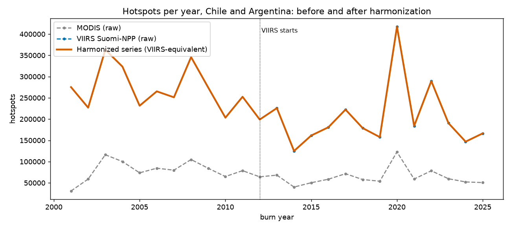

# Block 3 findings: MODIS against VIIRS, and the harmonization method

Sources: `notebooks/03_modis_vs_viirs.ipynb` and `scripts/harmonize.py`, re-run on 2026-11-14 on the
rows kept by the quality filter of block 1 (`docs/findings/01-quality.md`). Plan: `docs/eda-plan.md`,
block 3. `burn_date` is the day key and Suomi-NPP the VIIRS reference.

## Decisions

| Decision | Value | Evidence |
|---|---|---|
| Rows | Only hotspots with `keep` in `quality_flags.parquet` | The filter removes more VIIRS than MODIS (block 1), so the factors must be fitted on filtered rows |
| Units | VIIRS-equivalent hotspots | VIIRS is the sensor that continues |
| Method | Factor per region, calendar month and pass (day or night), shrunk towards the factor of the country, month and pass | Region and month beat three other candidates in every comparison. Splitting the passes is better in the stable years, which is the period the factors are applied to (see below) |
| Calibration window | 2012-2021 | MODIS orbits drift from 2022 (block 0) |
| NOAA-20 from November 2026 | No factor | NOAA-20 / Suomi-NPP is between 0.93 and 1.03 every year, 2019-2025 |
| Second metric | Fire-days (0.25° cell × day with fire) | Its VIIRS / MODIS ratio is lower and steadier: 1.7 to 2.1 |

## The harmonized dataset

Run `notebooks/01_quality.ipynb` once to create the quality flags, then `python scripts/harmonize.py`
(a few seconds). It writes, in `NASA_Data_Sources/processed/harmonized/`:

- `hotspots_kept.parquet`: the 7,000,520 hotspots that pass the filter, one row each (152 MB). The
  CSV download of the web app and notebook 03 read this file, so the filter, its checks and the
  region names live in one place.
- `cells_daily.parquet` (contract C2 in `docs/work-split.md`): 1,020,967 rows, 3 MB. The harmonized
  count of any area and period is the **sum of `hotspots_harmonized`**. A cell that crosses a region
  border has one row per region: always sum, never count rows.
- `factors.csv`: the 949 factors per region, month and pass. Day pass: 0.9 to 4.1, median 2.8
  (Argentina) and 2.7 (Chile). Night pass: 3.8 to 19.5, median 7.2 and 8.4.
- `validation_yearly.csv`.

The script stops if the flags file is missing or older than the hotspot table.

Region of the rows the polygons missed: they take `admin1_fixed` from block 1 only when that name,
with its encoding repaired as in `scripts/build_hotspots.py`, is a region of the row's own country.
This keeps one spelling per region (40 regions: 24 in Argentina, 16 in Chile) and no pair such as
Chile / Neuquén. 4 kept rows stay without region.

One sensor per period, so nothing is counted twice: MODIS before 2012-02-01, Suomi-NPP until
2026-10-31, NOAA-20 after. Factor: `(V + 200 × country_factor) / (M + 200)`, with V and M the
Suomi-NPP and MODIS counts of the region, month and pass in 2012-2021. Hotspots without a region use
the country factor of their month and pass. Before 2002-07-04 (no Aqua) a second set of factors,
fitted on Terra rows, applies.

## How different the sensors are

- **Overall:** Suomi-NPP sees 2.9 to 3.4 times as many hotspots as MODIS (Terra + Aqua) per year in
  2013-2021, and 3.7 times in 2022.
- **By pass:** against Aqua alone, the ratio is 3.4 to 4.0 in the afternoon pass and 13 to 19 in
  the night pass. MODIS misses most night fires.
- **By region:** from 2.1 (Los Ríos) to 5.9 (Neuquén) among the 33 regions with at least 500 MODIS
  hotspots. One national factor is not enough.
- **By size of the month:** no effect. The ratio stays between 2.7 and 3.4 from small to very large
  region-months, so a non-linear method is not needed.
- **Drift:** Aqua / Terra goes from 1.6-1.9 (2013-2023) to 2.1 in 2024 and 2.3 in 2025.

## Candidates and scores

Each candidate predicts the Suomi-NPP count of a region and month from its MODIS count.
WAPE = sum of absolute errors / sum of VIIRS over region-months (lower is better).

| Candidate | Argentina, leave-one-year-out | Chile, leave-one-year-out | Argentina, test 2022-2025 | Chile, test 2022-2025 |
|---|---|---|---|---|
| Country and month (v0) | 16.7% | 25.3% | 23.4% | 27.8% |
| Region, shrunk | 15.9% | 27.6% | 22.4% | 31.8% |
| **Region and month, shrunk** | **15.1%** | **24.6%** | **21.3%** | **24.6%** |
| Power law per region | 16.8% | 32.4% | 23.5% | 32.0% |

### Splitting the passes

Same region and month method, with a different MODIS input. `per pass` predicts day and night
separately, each from its own MODIS count, and adds them.

| Variant | Argentina, leave-one-year-out | Chile, leave-one-year-out | Argentina, test 2022-2025 | Chile, test 2022-2025 |
|---|---|---|---|---|
| All MODIS (region and month, above) | 15.1% | 24.6% | 21.3% | 24.6% |
| MODIS day pass only | 18.0% | 30.5% | 25.5% | 35.7% |
| Aqua only | 16.2% | 26.7% | 23.3% | 26.8% |
| **Per pass** | **13.9%** | **24.0%** | **20.0%** | 27.7% |

Mean error of the yearly total:

| Variant | Argentina, leave-one-year-out | Chile, leave-one-year-out | Argentina, test 2022-2025 | Chile, test 2022-2025 |
|---|---|---|---|---|
| All MODIS | 3.2% | 4.8% | 7.2% | 8.4% |
| Per pass | **2.1%** | 5.3% | 7.7% | 9.7% |

Per pass is the method in `scripts/harmonize.py`, but it is not a clear winner: it is better in 4 of
these 8 comparisons and worse in 4. It is kept because it wins the region and month error in both
countries in leave-one-year-out, which uses the stable-orbit years. The factors are applied to
2000-2011, also stable-orbit years; the test years are the drift years, where the pass times of
MODIS move. Block 4 reached the same recommendation from the night share of each sensor.
Going back to one factor for both passes would cost about one point of region and month error.

## How far the factors can be trusted before 2012

Fitting on one half of the stable overlap and predicting the other half gives a total error of
-1.0% (2012-2016 → 2017-2021) and -1.6% (the reverse). On filtered rows the factors are stable
inside the ten years we can check. Before the filter these errors were -5.0% and +3.6%.

## Limits to state in the app and the pitch

- A harmonized MODIS-era count is an estimate. Per year and country it is within about 2% (Argentina)
  and 5% (Chile) on average. Per region and month the typical error is 14% (Argentina) and 24% (Chile).
- Single years can be further off: predicted from MODIS, 2022 is 12% too low and 2024 is 13% too
  high. It does not affect the series, which uses VIIRS in those years, but it shows the size of the
  error an extreme or a drift year can have.
- Before July 2002 only Terra observed. Those factors are larger and noisier: 2000-2002 is the least
  reliable part of the series.
- The factor corrects the count, not the nature of the detection: night fires that MODIS did not see
  are added as a proportion, not recovered.
- The static-source mask only knows sources active in 2012-2025 (block 1).

## Not done from block 3

Matching of near-simultaneous detections (3.5), FRP analysis (3.6), event clustering (3.7) and
quantile mapping.
