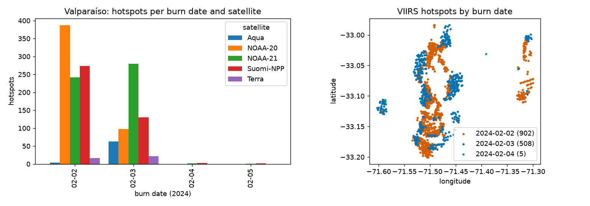

# Block 6 findings: past fire cases

Source: `notebooks/06_case_studies.ipynb`, run on 2026-11-14. Plan: `docs/eda-plan.md`, block 6.
Rows: `harmonized/hotspots_kept.parquet` (quality filter of block 1). Calendar values:
`harmonized/cells_daily.parquet` (VIIRS-equivalent hotspots). Days are `burn_date`.

## Decisions

| Decision | Value | Evidence |
|---|---|---|
| Demo case | Valparaíso and Viña del Mar, 2-3 February 2024 | Small area, 34 times the February median, and the clearest picture of what MODIS misses |
| MODIS-only cases | Torres del Paine (December 2011) and Paraná Delta (April 2008) | Both are before Suomi-NPP (first data on 2012-01-20), both have a dated source, both are flagged by the calendar |
| Chile 2017 | Not a MODIS-only case | Suomi-NPP recorded 28,477 hotspots in the window. `docs/population-and-past-fires.md` is corrected |
| A box is not an event | Report cases by box or region, and say so | A box around Puerto Patriada also holds a separate small fire two days earlier |

## What each satellite recorded

Hotspots inside the case window. "VIIRS / MODIS" is Suomi-NPP against Terra + Aqua.

| Case | Area | Window | Terra | Aqua | Suomi-NPP | NOAA-20 | NOAA-21 | VIIRS / MODIS | Peak day |
|---|---|---|---|---|---|---|---|---|---|
| Valparaíso and Viña del Mar | box | 1-7 Feb 2024 | 39 | 67 | 408 | 485 | 525 | 3.9 | 2 Feb 2024 |
| Ñuble, Biobío, La Araucanía | 3 regions | 30 Jan - 20 Feb 2023 | 3,993 | 4,304 | 27,608 | 25,853 | | 3.3 | 3 Feb 2023 |
| Central Chile | 4 regions | 10 Jan - 5 Feb 2017 | 3,963 | 4,679 | 28,477 | | | 3.3 | 25 Jan 2017 |
| Puerto Patriada, Chubut | box | 5 Jan - 14 Feb 2026 | 246 | 255 | 3,298 | 2,913 | 2,148 | 6.6 | 10 Jan 2026 |
| Córdoba | province | Sep 2024 | 490 | 671 | 4,553 | 4,001 | 4,289 | 3.9 | 22 Sep 2024 |
| Corrientes | province | Jan - Feb 2022 | 3,929 | 5,441 | 37,739 | 33,456 | | 4.0 | 18 Feb 2022 |
| Chilecito, La Rioja | box | Jul 2026 | 31 | 7 | 251 | 374 | 303 | 6.6 | 28 Jul 2026 |
| Torres del Paine | box | 26 Dec 2011 - 19 Jan 2012 | 58 | 48 | | | | | 29 Dec 2011 |
| Paraná Delta | box | Apr 2008 | 1,010 | 2,744 | | | | | 18 Apr 2008 |

- The gap between sensors is not one number: VIIRS saw 3.3 times as many hotspots as MODIS in the
  Chilean megafires and 6.6 times in Patagonia and La Rioja.
- All rows are final data except Chilecito, where 4% are near-real-time.
- The Paraná Delta peak, 18 April 2008, falls inside the days the smoke covered Buenos Aires
  (15 to 20 April).

## Does the calendar flag them?

Harmonized hotspots of the case month in the case area, against the same calendar month of the
other 25 years. Ratio = (x + 1) / (median + 1), as in block 4. Rank 1 is the highest of 26 years.

| Case | Month | Harmonized hotspots | Median of other years | Ratio | Rank | Era |
|---|---|---|---|---|---|---|
| Valparaíso and Viña del Mar | Feb 2024 | 410 | 11 | 34 | 1 | VIIRS |
| Ñuble, Biobío, La Araucanía | Feb 2023 | 28,064 | 482 | 58 | 1 | VIIRS |
| Central Chile | Jan 2017 | 28,388 | 703 | 40 | 1 | VIIRS |
| Puerto Patriada | Jan 2026 | 3,061 | 5 | 510 | 1 | VIIRS |
| Puerto Patriada | Feb 2026 | 238 | 6 | 36 | 4 | VIIRS |
| Córdoba | Sep 2024 | 4,553 | 843 | 5.4 | 3 | VIIRS |
| Corrientes | Jan 2022 | 14,346 | 535 | 27 | 1 | VIIRS |
| Corrientes | Feb 2022 | 23,393 | 837 | 28 | 1 | VIIRS |
| Chilecito | Jul 2026 | 252 | 8 | 29 | 3 | VIIRS |
| Torres del Paine | Dec 2011 | 514 | 0 | 515 | 1 | MODIS, estimated |
| Torres del Paine | Jan 2012 | 39 | 0 | 40 | 1 | MODIS, estimated |
| Paraná Delta | Apr 2008 | 16,203 | 66 | 242 | 1 | MODIS, estimated |

- Every case stands out: 9 of the 12 case months are the highest of the 26 years for their area, and
  the lowest ratio is 5.4.
- **Córdoba, September 2024, is rank 3**, not rank 1: two other Septembers had more hotspots in the
  province. The fire was severe for other reasons (it burned 76% of the year's area in one month),
  so the calendar measures activity, not damage.
- The two MODIS-era cases are flagged with the harmonized values. This is the practical test of the
  harmonization: an event from 2008 and one from 2011 rank first on the same scale as the VIIRS years.

## Valparaíso, 2-3 February 2024

Reported start: around midday on 2 February near Lago Peñuelas; first attack by CONAF at 12:31 local.

| Local time | Satellite | Pass | Hotspots |
|---|---|---|---|
| 2 Feb 14:47 | NOAA-20 | day | 32 |
| 2 Feb 15:10 | NOAA-21 | day | 36 |
| 2 Feb 15:38 | Suomi-NPP | day | 50 |
| 2 Feb 16:27 | NOAA-20 | day | 81 |
| 2 Feb 23:18 | Terra | night | 17 |
| 3 Feb 02:06 | NOAA-20 | night | 195 |
| 3 Feb 02:29 | NOAA-21 | night | 206 |
| 3 Feb 02:44 | Aqua | night | 4 |
| 3 Feb 02:56 | Suomi-NPP | night | 223 |
| 3 Feb 03:46 | NOAA-20 | night | 79 |

- **First detection: 14:47 local, 2 hours 16 minutes after the first attack on the ground.** Satellite
  hotspots confirm and map a fire; they did not give the first alarm here.
- **On the afternoon of 2 February, MODIS recorded no hotspot in the area.** The three VIIRS
  satellites recorded 199 in four passes. Terra's only day pass was in the morning, before the fire.
- **That night, within 12 minutes of each other, Aqua recorded 4 hotspots and Suomi-NPP 223.**
- **The day key matters here.** The passes between 02:06 and 03:46 on 3 February belong to
  `burn_date` 2 February: 923 hotspots on that burn date. By civil date, the same night would be split
  from its afternoon and the fire would look like it peaked on the 3rd.
- By 4 February the area has 5 hotspots.

## First detection against the reported start

| Case | Reported start | First detection (local) | Satellite | Difference |
|---|---|---|---|---|
| Valparaíso | 2 Feb 2024, about 12:00 | 2 Feb 2024 14:47 | NOAA-20 | same day, about 2.5 hours later |
| Puerto Patriada | 5 Jan 2026 | 5 Jan 2026 15:30 | NOAA-21 | same day |
| Torres del Paine | 27 Dec 2011 | 28 Dec 2011 03:13 | Aqua (night) | next day |

Only these three cases have a dated start in a source. For the others the sources give a month or a season.

Puerto Patriada: the box also contains 11 hotspots on 3 and 4 January, all at one spot 25 km
south-west of the main fire. They are a separate small fire, so the window starts on 5 January.
Without that check the "first detection" would have been one day before the fire started.

## Two cases only MODIS saw

| Case | MODIS hotspots | Harmonized | Factor applied | Reported size |
|---|---|---|---|---|
| Torres del Paine, 26 Dec 2011 - 19 Jan 2012 | 106 | 552 | 5.2 | about 17,600 ha |
| Paraná Delta, April 2008 | 3,754 | 16,203 | 4.3 | about 207,000 ha |

- The factor is not one number here either: 5.2 in Magallanes, 4.3 in the delta.
- Torres del Paine has very few detections for its size: 106 hotspots in 25 days. Hotspot counts and
  burned area are different things, and Patagonia is often cloudy.

## Limits

- A case is a box or a set of regions, not an event. Other fires inside the area and the window are
  counted too. Event clustering (block 3.7) was not done.
- The reported starts come from press and official sources, with the precision they give. Only
  Valparaíso has an hour.
- "First detection" is the first hotspot that passes the quality filter. A low-confidence detection
  earlier than that would not show.
- The ratios against the median use at most 25 other years, and small medians (0 to 11 hotspots) make
  very large ratios. Read the rank together with the ratio.
- Nothing here measures damage, people affected or burned area.

## Sources for the dates

- Valparaíso 2024: [CONAF report on the fire (Emol, 18 Apr 2024)](https://www.emol.com/noticias/Nacional/2024/04/18/1128243/conaf-informe-intencionalidad-incendio-valparaiso.html), [Ruta 68 closed (Emol, 2 Feb 2024)](https://www.emol.com/noticias/Nacional/2024/02/02/1120514/corte-ruta-68-por-incendio.html), [Andina](https://andina.pe/agencia/noticia-gran-incendio-forestal-obliga-a-evacuar-comunas-valparaiso-y-vina-del-mar-972958.aspx)
- Torres del Paine 2011: [The Clinic, 28 Dec 2011](https://www.theclinic.cl/2011/12/28/incendio-que-ha-quemado-20-hectareas-mantiene-en-alerta-roja-a-torres-del-paine/), [Emol, 30 Dec 2011](https://www.emol.com/noticias/nacional/2011/12/30/519446/zona-de-catastrofe-en-localidad-afectada-por-incendio-en-torres-del-paine.html)
- Paraná Delta 2008: [Secretaría de Ambiente report, April 2008](https://www.argentina.gob.ar/sites/default/files/2025/07/2008_-_abril_incendios_delta_del_rio_parana_1.pdf), [2008 Delta del Paraná wildfires (Wikipedia)](https://en.wikipedia.org/wiki/2008_Delta_del_Paran%C3%A1_wildfires)
- The other cases: `docs/population-and-past-fires.md`.
