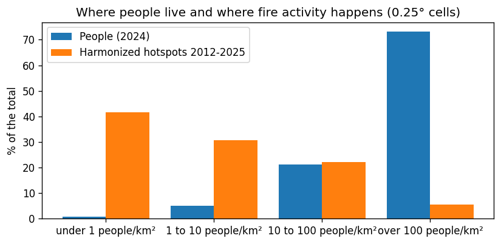

# Block 7 findings: population and exposure

Source: `notebooks/07_population.ipynb`, run on 2026-11-14 (about 40 seconds). Plan: `docs/eda-plan.md`,
block 7. Task: `docs/open-tasks.md`, task 2. Population: WorldPop R2025A, constrained, 2024, about
100 m (`./scripts/download_population.sh`). Fire: `harmonized/cells_daily.parquet` and
`harmonized/hotspots_kept.parquet`.

## Decisions

| Decision | Value | Evidence |
|---|---|---|
| Population source | WorldPop R2025A constrained, 2024, both countries | Same method on both sides of the border; 100 m resolves the wildland-urban interface |
| Chile total | **Rescaled to the 2024 census** (factor 0.9374), team decision | The raw raster is 6.68% above the census: WorldPop spreads a national total from pre-census projections, and the 2024 census counted about one million fewer people than projected. No-data, negative and non-finite pixels are excluded, so it is not a reading error |
| Argentina total | Not rescaled | 0.60% below the 2022 census, within the 5% tolerance |
| Aggregation | Sum of pixels per 0.25° cell, raster read in 0.5° strips | Grid total equals raster total in both countries; no averaging or interpolation |
| Border cells | One row per cell, people of both rasters summed | 200 cells have people in both rasters |
| Population year | 2024 for every fire year | WorldPop starts in 2015 (7.3 of the plan); stated as a limit, not fixed |
| Exposure measure for the pitch | People within 1, 5 and 10 km of the hotspots (step 5) | A 0.25° cell is about 25 km wide and overstates exposure (step 4) |

## Output

`NASA_Data_Sources/processed/population/cells.parquet` (not in git): 6,149 cells with people, columns
`cell_lat`, `cell_lon` (south-west corner), `population_2024`, `people_per_km2`. Total 64,098,210 people.
This is what the web app reads to show the people living in the selected area.

## 7.1 Rasters and census totals

| Country | Coordinate system | Pixel | No-data | Raster total | Census | Raw difference | Total used |
|---|---|---|---|---|---|---|---|
| Chile | EPSG:4326 | 3 arc-seconds (about 93 m) | -99999 | 19,714,431 | 18,480,432 (INE, Censo 2024) | +6.68% | 18,480,432 (rescaled) |
| Argentina | EPSG:4326 | 3 arc-seconds (about 93 m) | -99999 | 45,617,778 | 45,892,285 (INDEC, Censo 2022) | -0.60% | 45,617,778 |

The Chile raster reaches -109.45° because it includes Easter Island; those cells are outside the fire
analysis (block 1) but stay in the population grid.

## 7.2 Population per cell

- Chile 1,617 cells, Argentina 4,732, 200 shared: 6,149 cells.
- Half the cells hold fewer than 190 people; the busiest cells are Buenos Aires (4.5 and 4.3 million),
  Santiago (3.5 million) and Córdoba (1.3 million).

## 7.5 Fire activity against population density

Harmonized hotspots 2012-2025 per 0.25° cell, in classes of people per km².

| People per km² | Cells | Cells with fire | People (2024) | Harmonized hotspots 2012-2025 | % of people | % of hotspots | Hotspots per 1,000 people |
|---|---|---|---|---|---|---|---|
| under 1 | 3,946 | 2,810 | 448,947 | 1,187,352 | 0.7 | 41.7 | 2,645 |
| 1 to 10 | 1,356 | 1,334 | 3,196,922 | 869,245 | 5.0 | 30.6 | 272 |
| 10 to 100 | 717 | 714 | 13,623,075 | 631,501 | 21.3 | 22.2 | 46 |
| over 100 | 141 | 141 | 46,829,265 | 157,137 | 73.1 | 5.5 | 3.4 |

- **Most fire activity happens where few people live:** cells under 10 people per km² hold 72% of the
  hotspots and 6% of the people.
- **Most people live where fire activity is rare, not absent:** the 141 densest cells (73% of the
  people) still had 157,137 harmonized hotspots. That is where events like Valparaíso 2024 happen.
- Hotspot counts alone would point fire managers to the empty north of Argentina; population is what
  separates the dangerous events.

## 7.6 Two cases

People living in the 0.25° cells with fire on the peak days.

| Case | Days (`burn_date`) | Cells with fire | Harmonized hotspots | People in those cells | People per hotspot |
|---|---|---|---|---|---|
| Valparaíso 2024 (box) | 2 and 3 Feb 2024 | 3 | 403 | 1,009,728 | 2,506 |
| Ñuble, Biobío, La Araucanía 2023 | 3 Feb 2023 | 56 | 8,039 | 1,915,438 | 238 |

- The 2023 day had 19.9 times the hotspots of Valparaíso's two days.
- **Against the task's expectation, Valparaíso does not have more people in total at cell level:** the
  2023 fire touched 56 cells and Valparaíso 3, so the 2023 cells hold 1.9 times the people.
- **Per hotspot, Valparaíso is about ten times more exposed** (2,506 against 238 people). The cell
  measure is too coarse to show more: step 5 does.

## 7.4 People within 1, 5 and 10 km of the hotspots

WorldPop pixels whose centre is within the distance of at least one hotspot (every satellite, quality
filter of block 1, same days and areas as 7.6). Distances in metres, UTM zone 19S (EPSG:32719).
Chile pixels use the census rescale.

| Case | Hotspots (points) | Within 1 km | Within 5 km | Within 10 km |
|---|---|---|---|---|
| Valparaíso 2024 | 1,516 | 203,956 | 769,563 | 1,063,455 |
| Ñuble, Biobío, La Araucanía 2023 | 18,443 | 153,077 | 792,089 | 1,459,601 |

- **With 12 times fewer hotspots, Valparaíso had more people within 1 km of the fire** (204 thousand
  against 153 thousand) and about the same within 5 km. This is the number that tells the two events
  apart, and it matches what happened: 138 deaths against 25.

## Data note

`hotspots_kept.parquet` has 7,000,575 rows here against 7,000,520 in `docs/open-tasks.md`; the
FIRMS API files were downloaded later on 2026-11-14 and the near-real-time months had been revised
(the hotspot table has 8,042,448 rows against 8,042,380). `cells_daily.parquet` matches exactly
(1,020,967 rows).

## Limits

- **Exposure is not damage.** The numbers say who lives near fire activity, not who is affected.
- WorldPop models residents. Tourists and seasonal workers are not counted (relevant in summer, on the
  coast and in Patagonia).
- One population year (2024) is used for every fire year. WorldPop starts in 2015, so earlier years
  have no matching population.
- A 0.25° cell is about 25 km wide: step 4 counts everyone in the cell as exposed, which overstates it.
- The Chile rescale is one factor for the whole country; regional differences between WorldPop and the
  census are not corrected.
- Step 5 uses the hotspots of every satellite as points; a hotspot is a pixel of 375 m (VIIRS) or 1 km
  (MODIS), so distances of under 1 km are approximate.
- Step 5 needs `scipy`, which comes with `lightgbm` (already in `requirements.txt`).

## Sources

- WorldPop R2025A, 2015-2030 (100 m): https://hub.worldpop.org/geodata/listing?id=135
- INE Chile, Censo 2024, first results (18,480,432 people counted): https://www.ine.gob.cl/sala-de-prensa/prensa/general/noticia/2025/03/27/primeros-resultados-del-censo-2024-18.480.432-personas-fueron-censadas-en-chile-manteni%C3%A9ndose-la-tendencia-de-envejecimiento-de-la-poblaci%C3%B3n
- INDEC, Censo 2022, definitive results (45,892,285 people counted): https://www.cronista.com/economia-politica/censo-2022-resultados-definitivos-cuanto-envejecimos-los-argentinos-y-otros-tres-datos-clave
- Chile 2024 census below the previous projection (University of Chile): https://uchile.cl/noticias/226597/especialistas-uchile-analizan-primeros-resultados-del-censo-2024
