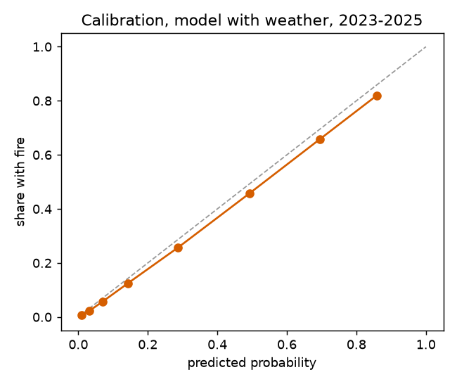

# Block 8 findings: risk model inputs, validation and weather

Sources: `notebooks/08_risk_inputs.ipynb`, `scripts/risk_baseline.py`, `scripts/risk_model.py`,
`scripts/risk_weather.py`, run on 2026-11-14. Plan: `docs/eda-plan.md`, block 8.

Target: at least one VIIRS hotspot in a 0.25° cell during a 7-day week (reference series: Suomi-NPP,
then NOAA-20; quality filter of block 1). Test years: 2023 to 2025, never seen in training.

## Decisions

| Decision | Value | Evidence |
|---|---|---|
| Risk layer in the app | Model with weather | Best of the three on every score and every test year |
| What weather is worth | Little: keep it, do not advertise it | Average precision 0.555 without it, 0.563 with it. Weather features carry 2.4% of the model's gain |
| Baseline to beat | Historical rate of the cell for that week, earlier years only | Average precision 0.510 |
| Score to report | Average precision, Brier score and "share of fire inside the top-ranked cell-weeks" | 90.6% of cell-weeks have no fire, so accuracy says nothing |
| Wording | "Where fire activity is most likely this week" | The model ranks places; it does not anticipate how severe a fire will be (Valparaíso below) |
| Large-fire target (8.1 of the plan) | Not defined | Needs events, which were not built (block 3.7) |

## The target

- Test years: 746,712 cell-weeks, 9.4% with fire.
- Per year the share with fire is 8.2% to 11.7%, and 14.4% in 2020.
- Fire is concentrated: of the 4,966 cells scored in the test years, 485 cells had fire in more than
  50 weeks and hold 48% of the fire cell-weeks; 1,098 cells had none.

## Baseline against model

Test years 2023-2025.

| | Average precision | Brier score | ROC AUC |
|---|---|---|---|
| Baseline | 0.510 | 0.0616 | 0.887 |
| Model, history only | 0.555 | 0.0577 | 0.900 |
| Model, with weather | 0.563 | 0.0572 | 0.902 |

Average precision per year:

| | 2023 | 2024 | 2025 |
|---|---|---|---|
| Baseline | 0.475 | 0.550 | 0.514 |
| Model, history only | 0.527 | 0.571 | 0.569 |
| Model, with weather | 0.534 | 0.582 | 0.573 |

In practice: if a team could only watch the cell-weeks ranked highest, the share of all fire
cell-weeks that falls inside them.

| Watching the top | Baseline | Model, history only | Model, with weather |
|---|---|---|---|
| 1% of cell-weeks | 8.6% | 8.8% | 8.9% |
| 5% | 32.7% | 35.4% | 36.0% |
| 10% | 52.6% | 56.7% | 57.1% |
| 20% | 74.9% | 78.1% | 78.5% |

- The model beats the baseline in every test year and at every cut.
- **The gain is modest.** Watching the top 10%, the model catches 57% of the fire activity and the
  plain historical rate catches 53%.

## What drives the model

Share of the model's gain (model with weather):

| Feature | Share |
|---|---|
| Historical rate of the cell and week (the baseline) | 56.4% |
| Fire in the cell in the previous 4 weeks | 28.6% |
| Fire in the 8 neighbouring cells the week before | 7.6% |
| Fire in the cell the week before | 1.9% |
| Position and season | 2.8% |
| All ten weather features | 2.4% (days since rain: 1.0%) |

**Persistence explains most of what the model adds.** A cell with fire the week before has fire again
45.8% of the time; a cell without it, 5.5%.

Why weather adds so little here, as far as this block can tell: the baseline and the season already
carry the average weather of each place and week, the weather grid is coarse (0.5°) and a week is a
long window. Whether finer or daily weather would do better was not tested.

## From one day to the next

Measured for the next phase (a view of tomorrow), with Suomi-NPP, 2013-2025, 0.25° cells and `burn_date`.

| Question | Answer |
|---|---|
| Share of all cell-days with fire | 2.56% |
| A cell with fire today has fire tomorrow | 33.3% of the time, 13 times the base rate |
| Of the cells with fire on a day, share that had fire the day before | 33.3% |
| Of the cells with fire on a day, share with fire the day before in the cell or one of its 8 neighbours | 64.7% |

About two thirds of tomorrow's fire cells are in or next to today's. The other third starts
somewhere that showed nothing the day before: that part cannot come from yesterday's hotspots, and it
is where weather forecasts and the seasonal baseline would have to help. Not tested.

## Calibration

The probabilities are close to honest and slightly too high: where the model says 29% the observed
share is 26%; where it says 86%, 82%. Read a probability as "about that much, a little less".

## A known case: Valparaíso, week of 29 January to 4 February 2024

2024 is a test year: this is what the model said without having seen it.

| Cell (south-west corner) | Fire that week | Baseline | Model, with weather | Percentile among all cells |
|---|---|---|---|---|
| -33.25, -71.50 | yes | 0.39 | 0.48 | 98 |
| -33.00, -71.50 | yes | 0.32 | 0.28 | 92 |
| -33.25, -71.75 | yes | 0.07 | 0.11 | 81 |
| -33.00, -71.75 | no | 0.03 | 0.04 | 63 |

- The two cells where the fire ran were in the top 8% of the country that week. The baseline already
  had them there (percentiles 96 and 93): this is a place and a season where hotspots are common.
- **The model did not say that this week would be a catastrophe, and it cannot.** It predicts that at
  least one hotspot is likely, not how large or how dangerous the fire will be. A probability of 0.48
  that week looks the same as in an ordinary summer week.

## Information leaks: what was checked

| Risk | How it is avoided |
|---|---|
| Test years seen in training | Train up to 2020, tune on 2021-2022, test on 2023-2025 |
| Baseline built with the year it predicts | The baseline of year Y uses years before Y only (tested) |
| Cells chosen because they burn later | Year Y is scored on cells with a detection before Y (tested) |
| Features from inside the week | Lags end the week before; weather windows end the day before the week |
| Target that grows with the number of satellites | One satellite at a time |
| Satellite outage counted as "no fire" | Outage weeks are not observed |

## Weather: coverage and alignment

- NASA POWER daily data, 1,466 points (one per 0.5° block with a fire cell), from September 2011.
  Downloaded on 2026-11-14 in about 2 hours.
- 1.5% of the model's rows have no weather; the model handles them as missing values.
- **The week in progress has no weather.** The last weather week starts on 2026-11-05, because POWER
  is three days behind. The outlook for the current week uses history alone.
- POWER days run from midnight to midnight local solar time; `burn_date` runs from 06:00 to 06:00.
  The 6-hour offset is not corrected.

## Limits

- The model predicts hotspots, not fires, damage or area. A cell-week with one hotspot counts the
  same as one with a thousand.
- Three test years. 2023 is the weakest for every method.
- No tests for `scripts/risk_model.py` or `scripts/risk_weather.py`.
- Weeks after the current one in the risk file carry the baseline, not the model.
- The model was tuned once (default LightGBM settings, early stopping). No search over settings.
- 2026 rows are near-real-time data and will change when FIRMS revises them.
