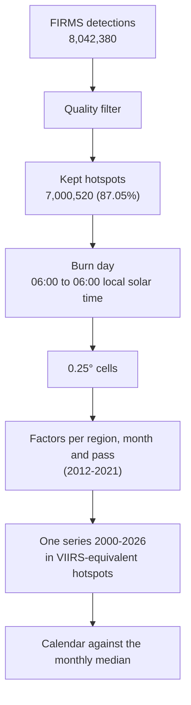

# Base case: harmonized hotspots and the burn calendar

Sources: `docs/findings/01-quality.md`, `03-modis-vs-viirs.md`, `04-calendar.md`, `docs/eda-findings.md`.

## 1. The problem

- **MODIS** (Terra, morning pass about 10:30; Aqua, afternoon pass about 13:30), from late 2000. Pixel
  of 1 km at nadir. NASA plans to end Terra data collection in January 2027 and Aqua around September
  2027; both orbits drift, with effects since late 2024.
- **VIIRS** (Suomi-NPP from 2012, NOAA-20 from 2018, NOAA-21 from 2023), afternoon pass about 13:30.
  Pixel of 375 m: it sees more and smaller fires.
- In Chile and Argentina, Suomi-NPP sees about 3 times as many hotspots as MODIS (day-pass factors 0.9
  to 4.1, median 2.8). Adding the raw counts creates a jump in 2012 that is the sensor, not the fire.

## 2. Pipeline

### Quality filter (`keep` in `quality_flags.parquet`)

- **Low confidence dropped** in both sensors. VIIRS `low` is daytime only and concentrated in the
  Atacama desert and the north-west: sun glint on bare ground.
- **Static heat sources**: a persistence mask applied to every row of both sensors (not the
  `fire_type` label, which changes with the MODIS collection and would create a fake decline).
- **Volcanoes and offshore**: `fire_type` 1 and 3, in standard-processing rows.
- Result: 14.9% of VIIRS rows and 6.9% of MODIS rows removed; 12.95% of all rows.

### Burn day

`burn_date` runs from 06:00 to 06:00 local solar time, so the afternoon pass and the following night
pass of one fire fall on the same day. Days, months and years are always counted with `burn_date`,
`burn_month` and `burn_year`; `acq_date` is UTC and only for matching FIRMS.

### One satellite per period

| Period | Satellite in the series |
|---|---|
| November 2000 to January 2012 | MODIS (Terra and Aqua) times the factor |
| February 2012 to October 2026 | Suomi-NPP |
| November 2026 on | NOAA-20, no factor (0.93 to 1.03 of Suomi-NPP per year, 2019-2025) |
| Suomi-NPP outage days | NOAA-20 (39 days in 2022, 2024 and 2026) |

Satellites are never added together.

## 3. Factors

For each region r (40: 24 in Argentina, 16 in Chile), calendar month m and pass p (day or night),
fitted on 2012-2021 (MODIS orbits drift from 2022):

$$\alpha_{r,m,p} = \frac{V_{r,m,p} + 200 \cdot \alpha_{\text{country},m,p}}{M_{r,m,p} + 200}$$

V and M are the Suomi-NPP and MODIS hotspots of that region, month and pass over the calibration
years. Regions with few MODIS detections move towards the country factor. Before 2002-07-04 (no Aqua)
a second set is fitted on Terra rows. 949 factors in all (`factors.csv`).

$$\hat{N}_{\text{VIIRS-eq}} = \alpha_{r,m,p} \cdot N_{\text{MODIS}} \quad \text{before February 2012}$$

### How well it works

| | Argentina | Chile |
|---|---|---|
| Region-month error (WAPE), leave one year out | 13.9% | 24.0% |
| Region-month error (WAPE), test 2022-2025 | 20.0% | 27.7% |
| Error of the yearly total, leave one year out | 2.1% | 5.3% |

Fitting on 2012-2016 and predicting 2017-2021 gives a total error of -1.0% (and -1.6% the other way).
Region and month beat three other candidates; the ratio does not depend on the size of the month, so
no non-linear method is needed.

## 4. Burn calendar

For any region, box or period, on 0.25° cells (about 700 km² at 25° S, 450 km² at 54° S):

$$R = \frac{x + 1}{M_m + 1}$$

x is the month's hotspots and M_m the median of the same month in the reference years: 2013 to the
last complete year by default (`reference=recent`), or every complete year (`reference=all`), always
leaving out the year being judged. The ratio is marked reliable only when the median is at least 10
hotspots. A partial month gets no ratio.

## 5. In the app and the API

- **Fireguard** (`/`): full-screen map with History, Now and Outlook views; the calendar and the CSV
  of the selected period are linked from it.
- **Calendar app** (`/#classic`): area by box or region, year by month grid, CSV.
- **API**: `/api/meta`, `/api/calendar`, `/api/hotspots.csv` (see `api.md`).
