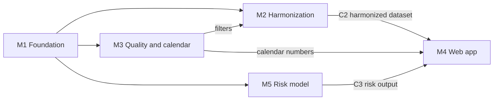

# Work split and pull request rules

Status: **proposal, pending team approval.** Deadline: Sunday 2026-11-15, 12:00 (Chile time).
Blocks refer to `docs/eda-plan.md`. Stack for the app: FastAPI + React (`docs/research-and-plan.md`).

## Modules and owners

| # | Module | Owner | Scope | Output |
|---|---|---|---|---|
| M1 | Foundation | Sebastian | Time fields, rebuilt table, block 0 (time audit) | Hotspot table with `burn_date` and the other time fields |
| M2 | Harmonization | Sebastian | Block 3 (MODIS vs VIIRS), harmonization method, before/after chart | Harmonized dataset (contract C2) |
| M3 | Quality and calendar | Vicente | Block 1 (filters, provisional 2026 months), then block 4 (calendar statistics, anomalies, rankings) | Filter decisions; calendar numbers the API serves |
| M4 | Web app | Felipe | FastAPI + React: area selection, burn calendar, anomaly, CSV download, risk layer | Running app, first on mock data |
| M5 | Risk model and demo case | Luciano | Block 8 (risk model), block 6 limited to Valparaíso 2024; block 7 (population) only if time allows | Risk output (contract C3), demo storyline |

Not assigned: blocks 2 and 5 (whoever finishes first), and the pitch, video and submission (everyone, from Sunday 08:00; it needs one owner).

M1 and M2 share an owner because they are sequential: no handoff on the critical path.

## Dependencies

Nobody waits for anybody:

- Until M1 is merged, M3 and M5 start on the current table (same rows, no `burn_date`).
- M4 builds against mock files that follow contracts C2 and C3.
- M5 trains on the VIIRS years only (2012 onward), so it does not depend on M2.
- M2 publishes a first version (v0, one national factor) early, so the app shows real data before the method is final.
- If a decision is still open when you need it, use the proposal in the "Decisions" table of `docs/eda-plan.md` and say so in the pull request.

## Contracts between modules

Changing a contract needs a message to the team and the agreement of the modules that read it.

### C1. Hotspot table (M1 → M2, M3, M5)

`NASA_Data_Sources/processed/hotspots/`, columns as in `CLAUDE.md` plus: `solar_time_h`, `pass_slot`, `burn_date`, `burn_year`, `burn_month`, `season_year`, `tz_name`, `utc_offset_min`, `local_wall_time`, `local_date`. Every count per day, month, year or season uses the `burn_*` columns, never `acq_date`.

### C2. Harmonized dataset (M2 → M4, M3)

`NASA_Data_Sources/processed/harmonized/cells_daily.parquet`, one row per cell and day with fire.

| Column | Meaning |
|---|---|
| `burn_date` | Day key |
| `cell_lat`, `cell_lon` | South-west corner of the 0.25° cell |
| `country`, `admin1` | From the hotspot table |
| `hotspots_harmonized` | VIIRS-equivalent hotspot count |
| `hotspots_raw` | Count before harmonization |
| `sensor` | Sensor the row comes from (MODIS or VIIRS) |
| `provisional` | True for NRT data |

The CSV download and the day view read the hotspot table (C1) directly.

### C3. Risk output (M5 → M4)

`NASA_Data_Sources/processed/risk/cells_weekly.parquet`: `week_start` (a `burn_date`), `cell_lat`, `cell_lon`, `probability` (0 to 1), `baseline_probability` (historical frequency for that cell and week).

### C4. API (M4)

Felipe defines the endpoints and documents them in the app's README. Dates travel as `YYYY-MM-DD` text and filter on `burn_date` (time rules in `docs/eda-plan.md`).

## File ownership

Edit only your own paths. This is what keeps pull requests free of conflicts.

| Path | Owner |
|---|---|
| `scripts/timefields.py`, `scripts/build_hotspots.py`, `tests/test_timefields.py`, `notebooks/00_*` | Sebastian (M1) |
| `scripts/harmonize*.py`, `notebooks/03_*`, `docs/findings/03-*` | Sebastian (M2) |
| `notebooks/01_*`, `notebooks/04_*`, `docs/findings/01-*`, `docs/findings/04-*` | Vicente |
| `app/` (`app/api/`, `app/web/`) | Felipe |
| `scripts/risk*.py`, `notebooks/06_*`, `notebooks/07_*`, `notebooks/08_*`, `docs/findings/06-*` to `08-*` | Luciano |

Shared files (`README.md`, `CLAUDE.md`, `CONTRIBUTING.md`, `requirements.txt`, `.gitignore`, `docs/eda-plan.md`):

- Change them in a small pull request that contains nothing else.
- `requirements.txt`: only add lines, at the end.
- Each block writes its results in its own `docs/findings/<NN>-<name>.md`. Nobody edits `CLAUDE.md` with findings during the hackathon; it is consolidated once at the end.
- A notebook has one owner. Never edit someone else's notebook: ask, or copy it.

## Pull request rules

1. **No direct pushes to `main`.** One branch per piece of work: `feat/m2-ratio-per-regime`, `fix/m4-calendar-colors`.
2. **Small and frequent.** Open a pull request when one sub-step works, not when the module is finished. Merge at least at every checkpoint.
3. **Before opening:** `git pull --rebase origin main`, then run `pytest` if you touched `scripts/` or `tests/`.
4. **Description:** what changed, how you checked it, and any decision that affects another module.
5. **Review:** one approval from any teammate. If the pull request touches only your own paths and nobody reviews it in 20 minutes, merge it yourself.
6. **Merge with squash**, then delete the branch.
7. **Never commit** data, `.env`, keys, or anything under `NASA_Data_Sources/` and `External_Data_Sources/`.
8. Commits and all content in English, Conventional Commits (`CONTRIBUTING.md`).

## Checkpoints (Chile time)

| When | What must be true |
|---|---|
| Sat 18:00 | M1 merged. Contracts confirmed. App skeleton runs on mock data. |
| Sat 22:00 | Harmonized v0 visible in the app. Go / no-go for the risk model: does it beat the baseline? |
| Sun 08:00 | Feature freeze. Final harmonized dataset and calendar in the app. |
| Sun 10:00 | Pitch, video and project page drafted. |
| Sun 12:00 | Submitted. |

## Risk model: scope and wording

- What it predicts: the probability of fire activity per cell and week. Not ignitions, not hectares, not damage.
- Baseline to beat: the historical frequency for that cell and week. Validation: train on past years, test on later years.
- A tabular model on this data trains in minutes on a laptop. No GPU is needed.
- If the model does not beat the baseline at the Saturday 22:00 checkpoint, the app shows the baseline as the risk layer and the pitch says so.
- Pitch wording: "where and when fire activity is most likely, so that resources can be positioned earlier". Do not claim that fires are predicted before they start.

## Open questions

- How the processed data reaches the app and the other laptops: each person rebuilds it with the scripts, or the final aggregated files are shared outside git.
- Who owns the pitch and the submission.
